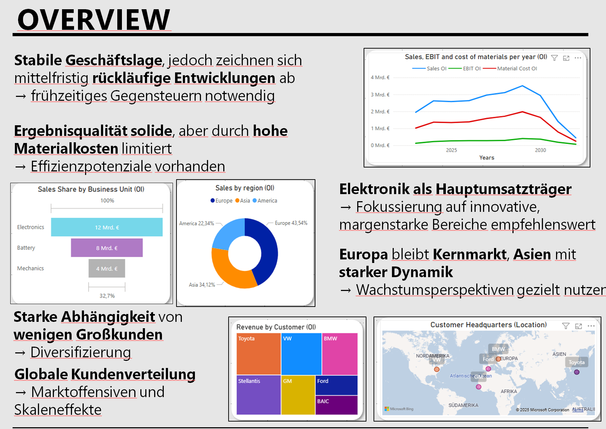
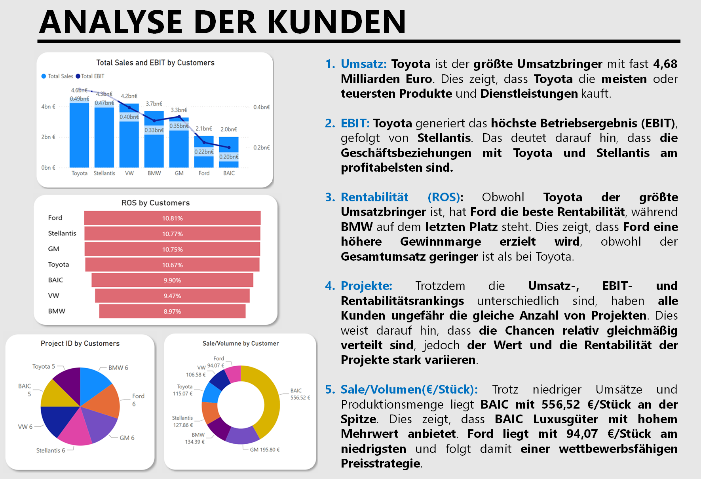
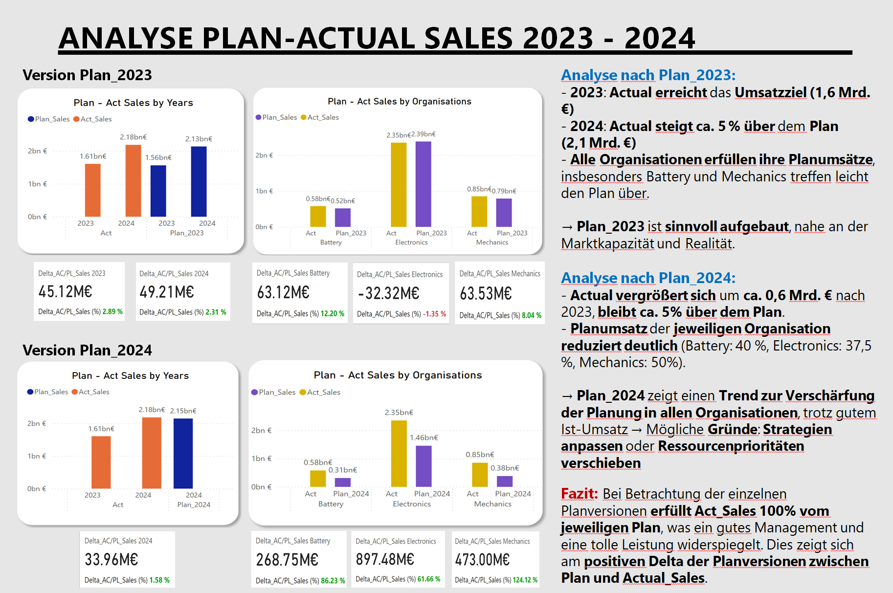

 
# Automotive Supplier Controlling & BI Performance Analysis (Power BI)

> **Kurzprofil für HR & Hiring Manager:** Projektdokumentation einer Studienarbeit im Modul *„Business Intelligence im Controlling“* (Gruppe von 4 Personen). Ziel war die Analyse von Finanz- und Betriebsdaten eines Automobilzulieferers (Tier-1) sowie der Aufbau eines interaktiven Power-BI-Dashboards zur Entscheidungsunterstützung des Managements, inklusive Präsentation vor Unternehmensvertretern[cite: 1].

---

## Executive Summary (30-Sekunden-Überblick)
* **Ausgangslage:** Auswertung von Umsatz, Materialkosten, EBIT, Volumen und Auftragseingang (*Order Intake / OI*) über drei Geschäftsbereiche (*Electronics, Battery, Mechanics*), sieben OEM-Kunden und drei Regionen[cite: 1].
* **Zentrale Erkenntnisse:**
  * **Deutliche Ergebnisunterschiede nach Bereich:** *Electronics* ist der wichtigste Ertragstreiber (ROS Ist: **11,76 %** in 2023 bzw. **12,92 %** in 2024), während *Mechanics* bei ca. 5 Mrd. € Umsatz einen **negativen ROS (-4,78 % in 2023; -3,26 % in 2024)** aufweist und dringenden Handlungsbedarf erfordert[cite: 1].
  * **Umsatz über Plan, Materialkosten über Budget:** Die Ist-Umsätze (*Act_Sales*) lagen ca. 5 % über den Planwerten (*Plan_2023 / Plan_2024*), zugleich lagen die Ist-Materialkosten (*Act_Mat*) durchgehend über Budget (z. B. **+4,11 %** gegenüber *Plan_2023* im Jahr 2023)[cite: 1].
  * **Projektlebenszyklus & Auslaufende Serien (EOP):** Ab ca. 2030 geht der Auftragseingang deutlich zurück, da bestehende Serienprojekte auslaufen – eine frühzeitige Akquisition von OEM-Nachfolgeprojekten ist entscheidend[cite: 1].
* **Tools & Methoden:** Microsoft Power BI, Power Query, DAX, Soll-Ist-Abweichungsanalyse (*Variance Analysis*), Margen- & ROS-Analyse, Lifecycle-Betrachtung[cite: 1].

---

## Fachlicher Mehrwert: Controlling & Buchhaltung

### 1. Controlling-Perspektive (Soll-Ist, Rentabilität, Forecast)
* **Soll-Ist-Vergleich (Plan vs. Actual):** Gegenüberstellung von *Ist* und verschiedenen Planversionen (*Plan_2023*, *Plan_2024*), um operative Mehrleistungen von reinen Plananpassungen zu trennen[cite: 1].
* **Marge vs. Volumen:** *Toyota* liefert den höchsten absoluten Umsatz (ca. 4,68 Mrd. €) und das höchste EBIT, während *Ford* mit **10,81 %** den höchsten ROS erzielt und *BAIC* mit **556,52 €/Stück** den höchsten Umsatz pro Volumen aufweist[cite: 1].

### 2. Schnittstelle zur Buchhaltung (Abstimmung, Kostenstellen, Perioden)
* **Datenabstimmung & Plausibilitätschecks:** Standardisierung von Währungseinheiten (`Mio. €` / `Mrd. €`) sowie Abgleich zwischen `Act_Sales`, `Act_Mat`, `Act_EBIT` und `Order Intake` zur frühzeitigen Erkennung von Auffälligkeiten[cite: 1].
* **Kosten- & Periodenkontrolle:** Bei Planüberschreitungen im Materialbereich (*Act_Mat*) – insbesondere in margenschwachen Einheiten wie *Mechanics* oder *Battery* – bildet das Dashboard eine Grundlage für die Abstimmung von Materialverbräuchen, Preisabweichungen und periodengerechter Abgrenzung mit der Buchhaltung[cite: 1].

---

## Dashboard-Übersicht

### 1. Executive & Segment Overview

*Überblick über Umsatz, EBIT, Volumen und Materialkostenstruktur nach Sparten (*Electronics, Battery, Mechanics*) sowie Projektverlauf[cite: 1].*

### 2. Kunden- & Profitabilitätsanalyse

*Vergleich von Umsatz, EBIT, Umsatzrendite (ROS) und Umsatz pro Volumen nach OEM-Kunden[cite: 1].*

### 3. Soll-Ist-Vergleich (Plan vs. Actual)

*Abweichungsanalyse (`Delta_AC/PL` absolut und in %) für Umsatz, Materialaufwand und EBIT nach Jahren und Organisationseinheiten[cite: 1].*

---

## Repository-Struktur
```text
├── README.md                      # Case-Study-Übersicht & Fachkontext
├── BIC_Dashboard.pbix             # Power-BI-Datenmodell und interaktives Dashboard[cite: 1]
├── BIC_Controlling_CaseStudy.pdf  # Bereinigte Präsentation für Bewerbungen
└── screenshots/                 # Vorschau-Screenshots der wichtigsten Ansichten
